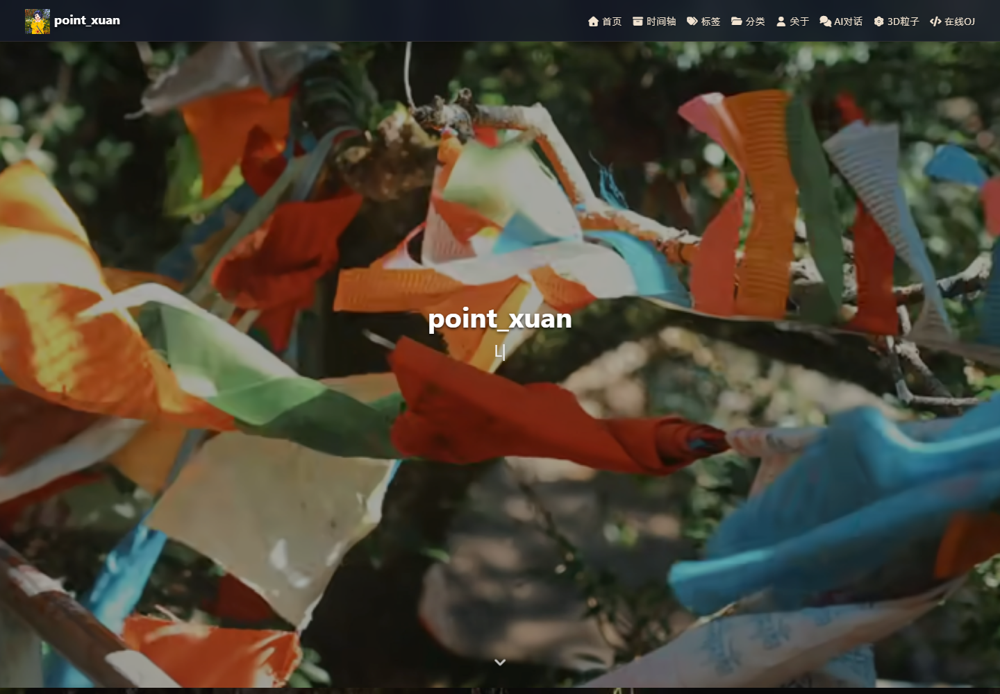

# point_xuan Blog + AcOJ

> 个人技术博客（Hexo + Butterfly）与在线判题系统 AcOJ（Node.js + Express + 腾讯云 CloudBase）的完整源码归档。博客负责文章、时间轴、标签、关于页与 OJ 入口；AcOJ 提供题库、代码提交、沙箱评测、排行榜与用户系统。


---

## 界面预览



博客首页：全屏背景图、个人签名、导航（首页 / 时间轴 / 标签 / 分类 / 关于 / AI 对话 / 3D 粒子 / 在线 OJ）。

---

## 仓库结构

```text
blog-oj/
├── source/                  # Hexo 文章、页面、静态资源
│   ├── _posts/              # 5 篇技术文章
│   ├── about/               # 关于页
│   ├── oj/                  # OJ 静态前端页面
│   ├── img/  css/  js/      # 主题定制资源
│   └── particle/            # 3D 粒子页
├── scaffolds/               # Hexo 模板
├── _config.yml              # Hexo 站点配置（已脱敏）
├── _config.butterfly.yml    # Butterfly 主题配置
├── package.json
├── oj-backend/              # AcOJ 后端
│   ├── app.js
│   ├── config.js            # 环境变量读取（已脱敏）
│   ├── routes/              # problems/submit/status/languages/users
│   ├── middleware/           # auth/rateLimit/roleCheck
│   ├── services/            # 邮件服务
│   ├── judge/sandbox.js     # 代码编译/运行/资源限制
│   └── public/oj/           # OJ 静态页面
├── .env.example
├── docs/screenshots/
└── README.md
```

---

## 技术栈

| 模块 | 技术 |
|---|---|
| 博客 | Hexo 7、Butterfly 主题、EJS/Pug/Stylus、Markdown、MathJax |
| 博客部署 | GitHub Pages（Hexo deployer） |
| OJ 后端 | Node.js 18、Express 4、Body-Parser、CORS、Nodemailer |
| 数据/存储 | 腾讯云 CloudBase（TCB Admin Node）、Redis |
| 判题 | 子进程编译执行（G++ / Java / Python），超时/内存/输出限制 |
| OJ 前端 | 原生 HTML/CSS/JS，API 调用后端 |

---

## 博客：本地运行

```bash
# 根目录
npm install
npx hexo server
# 打开 http://localhost:4000
```

生成静态站点：

```bash
npx hexo generate
# 产物在 public/
```

### 配置

`_config.yml` 中已移除真实 GitHub token / 服务器信息；`deploy.repo` 使用占位地址。部署时请改为你自己的仓库，并用 SSH key 或环境变量注入凭据：

```yaml
deploy:
  type: git
  repo: git@github.com:YOUR_NAME/YOUR_NAME.github.io.git
  branch: main
```

文章在 `source/_posts/`，新增文章：

```bash
npx hexo new "文章标题"
```

---

## AcOJ：本地运行

### 1. 环境要求

- Node.js **18+**
- Redis（可选但建议）
- 腾讯云 CloudBase 环境（或自行适配数据库层）
- 判题机需要 `g++`、`javac`/`java`、`python3`

### 2. 环境变量

复制模板并填写：

```bash
cp .env.example oj-backend/.env
```

关键变量：

```env
TCB_ENV_ID=
TCB_SECRET_ID=
TCB_SECRET_KEY=
TCB_REGION=ap-shanghai

PORT=3000
EMAIL_HOST=smtp.qq.com
EMAIL_PORT=465
EMAIL_USER=
EMAIL_PASS=
REDIS_URL=
```

> 仓库不包含任何真实 CloudBase Secret、邮箱密码或服务器密码。

### 3. 启动后端

```bash
cd oj-backend
npm install
npm start
# http://localhost:3000
# 健康检查 http://localhost:3000/api/health
```

静态 OJ 页面由 `oj-backend/public/oj/` 提供，根路径 `/` 打开题库。

### 4. 判题机安全

`judge/sandbox.js` 使用子进程编译运行用户代码。**生产环境必须**：

- 使用非 root 用户、独立容器/虚拟机
- 限制 CPU、内存、进程数、文件大小
- 禁止网络访问
- 清理临时目录
- 对提交接口做鉴权、限流与审计

---

## 测试与检查

### 博客

```bash
npm install
npx hexo clean
npx hexo generate
# 检查 public/index.html 与文章页面生成成功
```

### OJ 后端

```bash
cd oj-backend
npm install
node --check app.js
node --check config.js
node --check judge/sandbox.js
node app.js &
curl http://localhost:3000/api/health
```

### 手工验收

- [ ] 博客首页、文章、时间轴、标签、分类正常
- [ ] 关于页、AI 对话入口、3D 粒子页正常
- [ ] OJ 题库列表、题目详情
- [ ] 用户注册/登录/找回密码（邮件配置后）
- [ ] C++/Java/Python 提交与评测结果
- [ ] 提交记录、排行榜
- [ ] 管理端题目/用户/公告

---

## 已做的脱敏

| 内容 | 处理 |
|---|---|
| `_config.yml` GitHub deploy token | 替换为仓库地址占位 |
| `oj-backend/.env` | 删除，改为 `.env.example` |
| CloudBase SecretId/Key 默认值 | 改为只从环境变量读取 |
| CloudBase envId | 改为 `process.env.TCB_ENV_ID` |
| 部署脚本中的服务器密码/IP | 未纳入仓库 |
| `data/db.json` 用户数据 | 未纳入仓库 |
| 日志、构建产物、node_modules | 未纳入仓库 |

---

## 版权说明

- **代码**：MIT License（见 [LICENSE](LICENSE)）。
- **博客文章与图片**：归原作者所有；默认 **CC BY-NC 4.0**，转载请注明出处、不得商用。
- **Butterfly 主题 / Hexo / 各类依赖**：遵循各自开源许可证，通过 npm 安装，不在本仓库重复分发。

---

## 相关仓库

- 博客静态站点：<https://hhxpoint.github.io>
- 小火苗小程序：[hhxpoint/answer](https://github.com/hhxpoint/answer)
- 更多项目见 [hhxpoint GitHub](https://github.com/hhxpoint)
